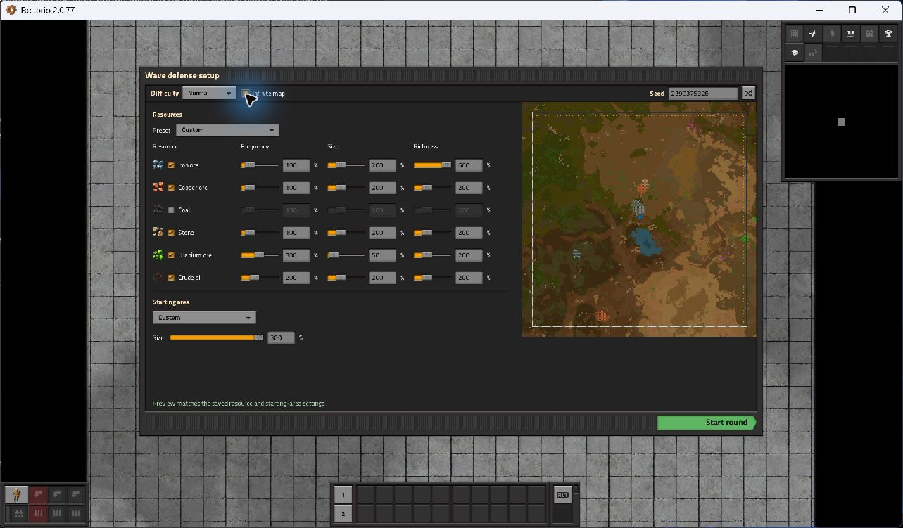

# Factorio Wave Defense Enhanced

**Version 0.3.0:** an integrated resource and starting-area setup panel for the
**built-in Wave Defense scenario**, targeting **Factorio 2.0.77**. The original
scenario still handles waves, difficulty, upgrades, victory, and defenses.



## Play

From this repository's PowerShell terminal:

```powershell
powershell.exe -NoProfile -ExecutionPolicy Bypass -File .\scripts\dev.ps1 RunWaveDefense
```

This opens vanilla Wave Defense in the isolated development profile with the mod
enabled. Alternatively, install the release ZIP into your Factorio mods folder,
enable it, and choose the built-in **Wave Defense** scenario.

1. Use the **Resources** panel beside the map preview on the Wave Defense
   starting screen. Each of the six resources has an icon, an enable checkbox,
   and **Frequency**, **Size**, and **Richness** sliders with percentage fields.
2. Choose **Wave Defense defaults**, **Freeplay resource defaults**, or **Custom**.
   Moving a resource slider switches to Custom while retaining the current
   preset's other values. Enable switches work with every preset.
3. Set starting area to **Follow difficulty** or **Custom**, then use its slider
   or percentage field. Walls, gates, and turrets scale with the generated area.
4. Press **Enter** in the seed field to regenerate with the same seed, or use
   **Shuffle** for a new seed. The status below the controls tells you when the
   preview needs updating; **Start** stays disabled until it matches the selected
   settings. Start the round when ready.

The same settings remain available through **Settings > Mod settings > Map**.
`/wde-status` reports applied settings and pending changes.

Settings are shared map settings; multiplayer admins control them and other
players see a read-only panel. Edits during
an active round remain pending until the next native preview regeneration or
round restart. Installing into an existing game does not rebuild its current
map. The mod does not change ordinary Freeplay or other scenarios.

## Settings and balance

Custom resource controls accept **1%-600%**; 100% is the native Freeplay
multiplier. Use each resource's enabled checkbox to turn generation off.
Frequency generally changes deposit count, size changes deposit size, and
richness changes ore quantity or oil yield. With the same game version and
settings, a fixed seed is reproducible; individual deposit counts do not
necessarily change monotonically.

The default preset preserves these stock Wave Defense multipliers:

| Resource | Frequency | Size | Richness |
| --- | ---: | ---: | ---: |
| Iron, copper, coal, stone | 100% | 200% | 200% |
| Crude oil | 200% | 200% | 200% |
| Uranium | 300% | 50% | 200% |

Starting area follows difficulty by default: **Easy 225%, Normal 175%, Hard
150%**. Custom area overrides this value independently of combat difficulty.
Its available range is **100%-300%**, and affects the enemy-free area together
with the scenario's starting perimeter. It does not change total map size.

The original scenario places walls and gates around the selected base size,
with turrets inside. Perimeters change in chunk-sized steps; nearby percentage
values can produce the same wall dimensions. Turret spacing and **50 firearm
magazines per turret** remain stock, so larger bases receive more turrets and
more total ammunition. Native terrain clipping and footprint clearing still
apply. For custom areas above 225%, the mod also queues surrounding chunks
beyond the enemy-free radius so native waves can find spawners. Larger areas
therefore take more terrain generation work. Disabling essential resources can
make a round unwinnable.

Preview updates use the existing seed and Shuffle controls. The built-in
scenario does not expose a regeneration API to ordinary mods, so slider edits
are pending until you regenerate. The mod does not resize an existing battle
map, change turret density, or support custom resources or overhaul mods that
remove vanilla resource controls.

## Start developing

Open this repository folder in VS Code. The following commands run from the
repository root in PowerShell:

```powershell
# Prepare the isolated game profile and repository-local formatter.
powershell.exe -NoProfile -ExecutionPolicy Bypass -File .\scripts\dev.ps1 Setup

# Install editor extensions and regenerate completion data for the installed game.
powershell.exe -NoProfile -ExecutionPolicy Bypass -File .\scripts\setup-editor.ps1

# Check metadata, Lua 5.2 syntax, and formatting.
powershell.exe -NoProfile -ExecutionPolicy Bypass -File .\scripts\dev.ps1 Validate

# Create a map, reload it, and run 600 ticks in the actual Factorio engine.
powershell.exe -NoProfile -ExecutionPolicy Bypass -File .\scripts\dev.ps1 Test

# Exercise the actual vanilla Wave Defense scenario with private local servers.
powershell.exe -NoProfile -ExecutionPolicy Bypass -File .\scripts\dev.ps1 TestWaveDefense

# Test real setup GUI elements using a saved Wave Defense game with a player.
$env:WDE_GUI_SAVE = 'C:\path\to\wave-defense-save.zip'
powershell.exe -NoProfile -ExecutionPolicy Bypass -File .\scripts\dev.ps1 TestWaveDefenseGui
```

Setup has already been completed on this computer. A separate standalone Lua
interpreter is unnecessary: Factorio supplies the runtime. `-ExecutionPolicy
Bypass` applies only to the command being run and does not change your system
execution policy.

If Factorio lives elsewhere, run `Setup -FactorioPath
"D:\SteamLibrary\steamapps\common\Factorio\bin\x64\factorio.exe"` after the
script path. `FACTORIO_PATH` is also supported. The selected path is saved locally
in `.dev/local.json`. Rerun editor setup after changing the game installation.

## Edit and debug

- **Ctrl+Shift+B** runs validation. Formatting happens when saving Lua files.
- In the command palette, run **Factorio: Select Version** and select the
  configured Factorio 2.0.77 installation on first use.
- Press **F5** with **Factorio: Debug Wave Defense (2.0)** selected. This opens
  the built-in scenario; enter `/wde-status` in the console.
- Set a breakpoint inside `commands.add_command` in `mod/control.lua`, then run
  `/wde-status` to exercise it. The Lua language server may ask once to trust its
  locally generated Factorio API plugin.
- Use **Terminal > Run Task** for Setup, Validate, Format, Smoke test, Test Wave
  Defense, Package, or Play Wave Defense.

Installed tools:

| Tool | Version / purpose |
| --- | --- |
| Factorio Mod Tool Kit | **2.0.14**, pinned for the Factorio 2.0 debugger |
| Lua Language Server | Lua 5.2 completion, diagnostics, and navigation |
| StyLua extension | Format on save |
| StyLua CLI | **2.6.0**, downloaded locally with a checked SHA-256 hash |

Keep FMTK on **2.0.14** while targeting this game version. Its 2.1 line targets
Factorio's newer debugger. Extension recommendations cannot pin versions; use
`setup-editor.ps1` to reproduce the compatible installation. Lua completion data
comes from the installed game's `doc-html` API JSON files and stays untracked.

## Local game profile

`.dev/config.ini` redirects game writes to `.dev/user-data/`, and all launch
commands use `.dev/mods/`. Setup creates a Windows directory junction from
`.dev/mods/wave-defense-enhanced` to `mod/`, so Factorio reads your current source
directly. Directory junctions do not require enabling Windows Developer Mode.

The profile enables `base` and this mod. Setup restores that small mod list for
reproducible tests; add other mod dependencies deliberately when development
needs them. Your regular `%APPDATA%\Factorio` mods, saves, and settings are not
part of this profile. Space Age is not required; the development profile
explicitly disables the bundled expansion mods.

- Development saves: `.dev/user-data/saves/`
- Captured test output: `.dev/logs/`
- Latest successful test details: `.dev/last-test.json`
- Game log: `.dev/user-data/factorio-current.log`
- Machine-specific editor configuration: `.vscode/settings.json` (untracked)

Use a new game or reload a save after changing runtime Lua. Prototype or setting
definition changes require restarting the game. Smoke tests create uniquely
named saves and retain their logs. The scenario suite uses Node.js, or VS Code's
bundled Node runtime when no standalone Node installation is available. Its
private servers bind to localhost and retain results under `.dev/wave-tests/`.
They do not verify interactive debugger breakpoints or real multiplayer clients.
The suite compares default maps against an unmodded server and exercises actual
resource entities, terrain-clipped defenses, pending settings, restart, save/load,
and wave attack groups. Its disposable mod copies include a test-only settings
writer. Because an empty server has zero native wave power, wave tests make the
small-biter price zero only in that test save; native spawner selection, pathing,
and attack commands still run. For stock-size bases the clientless test also
generates the native preview's 320-tile extent, since no minimap is open. At 300%
the wave checks make no test terrain requests and rely on the mod's own outer
generation. None of these test accommodations is included in the release.

The GUI suite needs a local Wave Defense save containing a player because the
runtime cannot create players on an empty server. Set `WDE_GUI_SAVE` as shown
above; this machine's earlier GUI-test autosave is the fallback. If neither is
available, the suite explicitly skips. It loads the player offline, tests real
GUI elements through a disposable adapter, and checks presets, decimal input,
invalid edits, admin restrictions, pending changes, and native frame rebuilds.
Mouse interaction and layout still require an interactive client check.

## Format and package

```powershell
powershell.exe -NoProfile -ExecutionPolicy Bypass -File .\scripts\dev.ps1 Format
powershell.exe -NoProfile -ExecutionPolicy Bypass -File .\scripts\dev.ps1 Package
```

Packaging validates first, then writes
`dist/wave-defense-enhanced_0.3.0.zip` with the required mod folder inside it.
Only files from `mod/` are packaged. Rebuilding replaces that version's local
archive. Increment `mod/info.json` and add a `mod/changelog.txt` entry when
preparing a new version.

## Source layout

```text
mod/
  info.json              Identity, target game version, dependencies
  control.lua            Runtime events, persistent state, status command
  settings.lua           Map setting prototypes and defaults
  scripts/config.lua     Settings resolution and map-generation overrides
  scripts/setup_gui.lua  Resource controls inside the native setup screen
  data.lua               Prototype-stage entry point
  locale/en/wave-defense-enhanced.cfg  English strings
  locale/en/setup-gui.cfg Setup panel strings
  changelog.txt          Factorio-formatted change history
scripts/
  dev.ps1                Setup, checks, formatting, game tests, packaging, play
  setup-editor.ps1       Compatible extensions and game-specific Lua definitions
  test-wave-defense.mjs  Real-scenario integration tests using local RCON
  test-wave-defense-gui.mjs  Setup GUI engine tests using a local player save
.vscode/                 Tasks, debugger configuration, extension recommendations
```

Use `storage` for persistent runtime state and keep simulation behavior
deterministic for multiplayer. Register runtime events and commands in
`control.lua`; add prototype definitions through `data.lua` and modules it
loads. Applied configuration snapshots persist across save/load.

## Integration design

The mod recognizes `script.level` as `base/wave-defense`, checks the scenario's
remote interface, and handles its newly created `Surface N` before any chunks
exist. It updates only resource autoplace controls and, when requested, starting
area. Everything else, including enemy settings and island/infinite terrain,
stays under the original scenario's control.

Factorio raises `on_surface_created` synchronously. The stock scenario then
queries the updated starting-area radius before generating chunks and placing
defenses. This also keeps its attack targeting consistent with the base size.
No base-game files are modified or redistributed; no replacement scenario is
required. The mod deliberately avoids vanilla's wholesale remote `set_config`
operation, which can disconnect its active difficulty table from its config.

`wave_defense_enhanced.get_status` is a read-only remote interface for diagnostics.
Future changes to the built-in scenario require rerunning the integration suite.

The setup adapter recognizes the scenario-owned preview frame, preserves its
native seed, difficulty, and Start controls, and adds a resource panel alongside
a copy of its minimap. It reattaches after vanilla rebuilds the frame and checks
pending settings before enabling Start. It only operates in `base/wave-defense`.
If removing the mod from a save made on this screen, confirm the seed or click
Shuffle once so vanilla rebuilds its original preview widgets.

## Git

The public repository is [moloch--/Factorio-WaveDef-Enhanced](https://github.com/moloch--/Factorio-WaveDef-Enhanced).
The local `main` branch tracks `origin/main`. Generated profiles, saves, tools,
API definitions, and ZIPs are ignored. Commit identity is configured for this
repository only, using the authenticated GitHub account and its GitHub noreply
address.

No license has been selected for this project yet.

## References

- [Factorio mod structure](https://lua-api.factorio.com/latest/auxiliary/mod-structure.html)
- [Factorio command-line options](https://wiki.factorio.com/Command_line_parameters)
- [FMTK 2.0.14 configuration](https://github.com/justarandomgeek/vscode-factoriomod-debug/blob/2.0.14/package.json)
- [FMTK Lua integration](https://github.com/justarandomgeek/vscode-factoriomod-debug/blob/2.0.14/doc/language-lua.md)
- [StyLua](https://github.com/JohnnyMorganz/StyLua)

The installed Factorio `doc-html/index.html` is the API reference matching your
game. Online `latest` documentation may describe a newer version.
